# Architektur

Welche Dienste es gibt, wer mit wem spricht, wozu und mit welchen Daten, und welche Seite welcher Client ausliefert.

:::info Pilot
Das Modell liegt in [`schulcloud-server/architecture`](https://github.com/hpi-schul-cloud/schulcloud-server/tree/main/architecture)
und ist mit [LikeC4](https://likec4.dev) beschrieben. Diagramme und Ansichten auf dieser Seite werden daraus erzeugt.
:::

**[Interaktiv ansehen →](pathname:///architecture/)**: Elemente anklicken und aufklappen, Beziehungen mit Zweck, Technik und Quelle im Code.

Prinzipien und Muster im Backend: [Backend-Architektur](../backend-design-patterns/architecture.md).

## Ansichten

| Ansicht | Inhalt |
|---|---|
| [SVS: Systemübersicht](pathname:///architecture/#/view/index/) | Welche Dienste es gibt und wer mit wem spricht. Einstieg für neue Entwicklerinnen und Entwickler. |
| [SVS: Dienste und Datenspeicher](pathname:///architecture/#/view/svs/) | Alle Dienste, Datenspeicher und externen Systeme mit ihren Verbindungen. |
| [schulcloud-server: Rollen und Jobs](pathname:///architecture/#/view/server/) | Alle Deployments und Jobs aus dem Server-Image und woran sie hängen. |
| [Seiten: wer sie ausliefert und welche APIs sie rufen](pathname:///architecture/#/view/pages/) | Fachbereiche von nuxt-client und schulcloud-client mit ihren Pfaden. #split = auf beide Clients verteilt, #dead = Pfad ohne Seite. |
| [Migration: was in welchem Client liegt](pathname:///architecture/#/view/migration/) | Nur die Fachbereiche, die auf beide Clients verteilt sind, und Pfade ohne Seite. |
| [Datenschutz: Flüsse personenbezogener Daten](pathname:///architecture/#/view/pii/) | Nur Verbindungen mit personenbezogenen Daten. Vorlage für Verarbeitungsverzeichnis und TOMs. |
| [RabbitMQ: Exchanges, Publisher und Consumer](pathname:///architecture/#/view/async/) | Wer welche Nachrichten einstellt und wer sie verarbeitet. |
| [file-storage: Abhängigkeiten](pathname:///architecture/#/view/files/) | Was am Dateidienst hängt und woran er hängt. |
| [Login und Identitäten](pathname:///architecture/#/view/identity/) | Wie Nutzer angelegt und angemeldet werden: OIDC, Schulconnex, LDAP, TSP, Hydra. |
| [Mandant brb: Brandenburg](pathname:///architecture/#/view/brb/) | Was in Brandenburg läuft. Ohne Komponenten, die nur andere Mandanten haben. |
| [Mandant nbc: Niedersachsen](pathname:///architecture/#/view/nbc/) | Was in Niedersachsen läuft. Ohne Komponenten, die nur andere Mandanten haben. |
| [Mandant thr: Thüringen](pathname:///architecture/#/view/thr/) | Was in Thüringen läuft. Ohne Komponenten, die nur andere Mandanten haben. |
| [Mandant dbc: dBildungscloud](pathname:///architecture/#/view/dbc/) | Was in der dBildungscloud läuft. Ohne Komponenten, die nur andere Mandanten haben. |

Große Ansichten sind nur interaktiv lesbar. Die kleinen stehen hier direkt.

## Kennzeichnungen

| Tag | Bedeutung |
|---|---|
| `#pii` | Verbindung überträgt personenbezogene Daten. Die Beschreibung nennt die Kategorien. |
| `#async` | Verbindung läuft über RabbitMQ |
| `#brb` `#nbc` `#thr` `#dbc` | Nur bei diesem Mandanten ausgerollt. Ohne Tag: überall. |
| `#split` | Fachbereich ist auf nuxt-client und schulcloud-client verteilt |
| `#dead` | Pfad oder Route ohne funktionierende Seite |
| `#disabled` | Ausgerollt, in Produktion abgeschaltet |
| `#dev` | Nur in Dev-Namespaces |

## SVS: Systemübersicht

Welche Dienste es gibt und wer mit wem spricht. Einstieg für neue Entwicklerinnen und Entwickler.

[Interaktiv öffnen →](pathname:///architecture/#/view/index/)

```mermaid
graph TB
  Nextcloud@{ shape: rectangle, label: "Nextcloud" }
  Tools@{ shape: rectangle, label: "Externe Tools" }
  Hidrive@{ shape: rectangle, label: "Strato HiDrive" }
  User@{ shape: rounded, label: "Nutzerinnen und Nutzer" }
  Support@{ shape: rounded, label: "Support" }
  Svs@{ shape: rectangle, label: "SVS" }
  Idp@{ shape: rectangle, label: "Externe OIDC-IdPs" }
  Schulconnex@{ shape: rectangle, label: "Schulconnex-API" }
  Ldap@{ shape: rectangle, label: "Schul-LDAP" }
  Tsp@{ shape: rectangle, label: "TSP Thüringen" }
  Vidis@{ shape: rectangle, label: "VIDIS" }
  Bilo@{ shape: rectangle, label: "BILO" }
  Bbb@{ shape: rectangle, label: "BigBlueButton" }
  H5pHub@{ shape: rectangle, label: "H5P Hub" }
  Smtp@{ shape: rectangle, label: "SMTP-Relay" }
  Cachet@{ shape: rectangle, label: "Cachet" }
  Web@{ shape: rectangle, label: "Beliebige Webseiten" }
  Svs -. "`Login über OIDC`" .-> Idp
  Svs -. "`[...]`" .-> Schulconnex
  Svs -. "`[...]`" .-> Ldap
  Svs -. "`[...]`" .-> Tsp
  Svs -. "`Medien-Metadaten`" .-> Vidis
  Svs -. "`Medien-Metadaten`" .-> Bilo
  Svs -. "`Konferenzen anlegen und beitreten`" .-> Bbb
  Nextcloud -. "`Login über SVS`" .-> Svs
  Svs -. "`Gruppen und Ordner für Teams`" .-> Nextcloud
  Tools -. "`[...]`" .-> Svs
  Svs -. "`Tools starten`" .-> Tools
  Svs -. "`Bibliotheken laden`" .-> H5pHub
  Svs -. "`E-Mails versenden`" .-> Smtp
  Svs -. "`Störungsmeldungen`" .-> Cachet
  Svs -. "`Link-Vorschau laden`" .-> Web
  User -. "`[...]`" .-> Svs
  Support -. "`Verwaltet Schulen und Nutzer`" .-> Svs
```

## Migration: was in welchem Client liegt

Nur die Fachbereiche, die auf beide Clients verteilt sind, und Pfade ohne Seite.

[Interaktiv öffnen →](pathname:///architecture/#/view/migration/)

```mermaid
graph TB
  SvsNuxtNRooms@{ shape: rounded, label: "Räume und Kurse" }
  SvsNuxtNTasks@{ shape: rounded, label: "Aufgabenübersicht" }
  SvsNuxtNNews@{ shape: rounded, label: "Neuigkeiten" }
  SvsNuxtNAdmin@{ shape: rounded, label: "Administration (neu)" }
  SvsNuxtNDead@{ shape: rounded, label: "Pfade ohne Seite" }
  SvsLegacyLCourses@{ shape: rounded, label: "Kurse bearbeiten" }
  SvsLegacyLHomework@{ shape: rounded, label: "Aufgaben" }
  SvsLegacyLTeams@{ shape: rounded, label: "Teams" }
  SvsLegacyLAdmin@{ shape: rounded, label: "Administration (alt)" }
```

## RabbitMQ: Exchanges, Publisher und Consumer

Wer welche Nachrichten einstellt und wer sie verarbeitet.

[Interaktiv öffnen →](pathname:///architecture/#/view/async/)

```mermaid
graph TB
  subgraph SvsServer["`schulcloud-server`"]
    SvsServer.Api@{ shape: rectangle, label: "api" }
    SvsServer.BoardCollab@{ shape: rectangle, label: "board-collaboration" }
    SvsServer.CommonCartridge@{ shape: rectangle, label: "common-cartridge" }
    SvsServer.LdapSyncConsole@{ shape: rectangle, label: "ldap-sync-console" }
    SvsServer.SchulconnexConsumers@{ shape: rectangle, label: "Schulconnex-Consumer" }
    SvsServer.Worker@{ shape: rectangle, label: "api-worker" }
  end
  subgraph SvsFiles["`file-storage`"]
    SvsFiles.Api@{ shape: rectangle, label: "file-storage api" }
    SvsFiles.Consumer@{ shape: rectangle, label: "file-storage consumer" }
    SvsFiles.PreviewGenerator@{ shape: rectangle, label: "preview-generator" }
  end
  subgraph SvsAntivirus["`antivirus_check_service`"]
    SvsAntivirus.Web@{ shape: rectangle, label: "antivirus web" }
    SvsAntivirus.Scanfile@{ shape: rectangle, label: "antivirus scanfile" }
  end
  subgraph SvsRabbit["`RabbitMQ`"]
    SvsRabbit.ExFiles@{ shape: horizontal-cylinder, label: "files-storage" }
    SvsRabbit.ExH5p@{ shape: horizontal-cylinder, label: "h5p-editor" }
    SvsRabbit.ExProvisioning@{ shape: horizontal-cylinder, label: "provisioning-schulconnex" }
    SvsRabbit.ExMail@{ shape: horizontal-cylinder, label: "mail-drop" }
    SvsRabbit.QLdap@{ shape: horizontal-cylinder, label: "sync_ldap" }
    SvsRabbit.ExAntivirus@{ shape: horizontal-cylinder, label: "scan_file_v2" }
    SvsRabbit.ExPreview@{ shape: horizontal-cylinder, label: "files-preview" }
  end
  subgraph SvsH5p["`h5p-server`"]
    SvsH5p.Consumer@{ shape: rectangle, label: "h5p consumer" }
  end
  SvsMaildrop@{ shape: rectangle, label: "maildrop" }
  SvsServer.Api -. "`Dateioperationen anstoßen`" .-> SvsRabbit.ExFiles
  SvsServer.Api -. "`H5P-Inhalte kopieren und löschen`" .-> SvsRabbit.ExH5p
  SvsServer.Api -. "`Provisionierung beim Login anstoßen`" .-> SvsRabbit.ExProvisioning
  SvsServer.Api -. "`E-Mail versenden`" .-> SvsRabbit.ExMail
  SvsServer.BoardCollab -. "`Dateien von Board-Elementen`" .-> SvsRabbit.ExFiles
  SvsServer.CommonCartridge -. "`Dateien im Paket`" .-> SvsRabbit.ExFiles
  SvsServer.LdapSyncConsole -. "`Sync pro Schule einstellen`" .-> SvsRabbit.QLdap
  SvsFiles.Api -. "`Scan anstoßen`" .-> SvsRabbit.ExAntivirus
  SvsFiles.Api -. "`Vorschau anstoßen`" .-> SvsRabbit.ExPreview
  SvsAntivirus.Web -. "`Scan einstellen`" .-> SvsRabbit.ExAntivirus
  SvsRabbit.ExFiles -. "`Dateioperationen`" .-> SvsFiles.Consumer
  SvsRabbit.ExH5p -. "`Kopieren und Löschen`" .-> SvsH5p.Consumer
  SvsRabbit.ExProvisioning -. "`Provisionierung`" .-> SvsServer.SchulconnexConsumers
  SvsRabbit.ExMail -. "`E-Mail-Aufträge`" .-> SvsMaildrop
  SvsRabbit.ExAntivirus -. "`Scanauftrag`" .-> SvsAntivirus.Scanfile
  SvsRabbit.ExPreview -. "`Vorschau erzeugen`" .-> SvsFiles.PreviewGenerator
  SvsRabbit.QLdap -. "`LDAP-Sync ausführen`" .-> SvsServer.Worker
```

## file-storage: Abhängigkeiten

Was am Dateidienst hängt und woran er hängt.

[Interaktiv öffnen →](pathname:///architecture/#/view/files/)

```mermaid
graph TB
  subgraph SvsNuxt["`nuxt-client`"]
    SvsNuxt.NBoards@{ shape: rounded, label: "Boards und Ordner" }
    SvsNuxt.NCollabora@{ shape: rounded, label: "Office-Dokumente" }
  end
  SvsSuperhero@{ shape: rounded, label: "superhero-dashboard" }
  subgraph SvsServer["`schulcloud-server`"]
    SvsServer.Api@{ shape: rectangle, label: "api" }
  end
  subgraph SvsAntivirus["`antivirus_check_service`"]
    SvsAntivirus.Scanfile@{ shape: rectangle, label: "antivirus scanfile" }
  end
  SvsCollabora@{ shape: rectangle, label: "Collabora" }
  subgraph SvsRabbit["`RabbitMQ`"]
    SvsRabbit.ExFiles@{ shape: horizontal-cylinder, label: "files-storage" }
    SvsRabbit.ExPreview@{ shape: horizontal-cylinder, label: "files-preview" }
    SvsRabbit.ExAntivirus@{ shape: horizontal-cylinder, label: "scan_file_v2" }
  end
  subgraph SvsFiles["`file-storage`"]
    SvsFiles.Api@{ shape: rectangle, label: "file-storage api" }
    SvsFiles.Consumer@{ shape: rectangle, label: "file-storage consumer" }
    SvsFiles.PreviewGenerator@{ shape: rectangle, label: "preview-generator" }
  end
  SvsMongo@{ shape: disk, label: "MongoDB" }
  SvsS3@{ shape: disk, label: "S3" }
  SvsNuxt.NBoards -. "`Dateien im Board`" .-> SvsFiles.Api
  SvsNuxt.NCollabora -. "`WOPI-URL holen`" .-> SvsFiles.Api
  SvsSuperhero -. "`Dateien verwalten`" .-> SvsFiles.Api
  SvsServer.Api -. "`Dateien kopieren und löschen`" .-> SvsFiles.Api
  SvsAntivirus.Scanfile -. "`Datei laden, Ergebnis melden`" .-> SvsFiles.Api
  SvsCollabora -. "`Dokument laden und speichern`" .-> SvsFiles.Api
  SvsRabbit.ExFiles -. "`Dateioperationen`" .-> SvsFiles.Consumer
  SvsRabbit.ExPreview -. "`Vorschau erzeugen`" .-> SvsFiles.PreviewGenerator
  SvsFiles.Api -. "`Rechte prüfen`" .-> SvsServer.Api
  SvsFiles.Api -. "`Datei-Metadaten`" .-> SvsMongo
  SvsFiles.Api -. "`Dateiinhalte`" .-> SvsS3
  SvsFiles.Api -. "`Scan anstoßen`" .-> SvsRabbit.ExAntivirus
  SvsFiles.Api -. "`Vorschau anstoßen`" .-> SvsRabbit.ExPreview
  SvsFiles.Consumer -. "`Datei-Metadaten`" .-> SvsMongo
  SvsFiles.Consumer -. "`Kopieren und Löschen`" .-> SvsS3
  SvsFiles.PreviewGenerator -. "`Bilder lesen, Vorschau schreiben`" .-> SvsS3
```

## Login und Identitäten

Wie Nutzer angelegt und angemeldet werden: OIDC, Schulconnex, LDAP, TSP, Hydra.

[Interaktiv öffnen →](pathname:///architecture/#/view/identity/)

```mermaid
graph TB
  subgraph Svs["`SVS`"]
    subgraph Svs.Legacy["`schulcloud-client`"]
      Svs.Legacy.LLogin@{ shape: rounded, label: "Login und SSO" }
    end
    subgraph Svs.Server["`schulcloud-server`"]
      Svs.Server.Api@{ shape: rectangle, label: "api" }
      Svs.Server.IdpConsole@{ shape: rectangle, label: "idp-console" }
      Svs.Server.LdapSyncConsole@{ shape: rectangle, label: "ldap-sync-console" }
      Svs.Server.SchulconnexConsumers@{ shape: rectangle, label: "Schulconnex-Consumer" }
      Svs.Server.Worker@{ shape: rectangle, label: "api-worker" }
      Svs.Server.TspSyncConsole@{ shape: rectangle, label: "tsp-sync-console" }
      Svs.Server.MigrationSystems@{ shape: rectangle, label: "api-migration-systems" }
    end
    Svs.Hydra@{ shape: rectangle, label: "Hydra" }
  end
  Idp@{ shape: rectangle, label: "Externe OIDC-IdPs" }
  Tools@{ shape: rectangle, label: "Externe Tools" }
  Nextcloud@{ shape: rectangle, label: "Nextcloud" }
  Schulconnex@{ shape: rectangle, label: "Schulconnex-API" }
  Ldap@{ shape: rectangle, label: "Schul-LDAP" }
  Tsp@{ shape: rectangle, label: "TSP Thüringen" }
  Svs.Legacy.LLogin -. "`Anmelden`" .-> Svs.Server.Api
  Svs.Legacy.LLogin -. "`OAuth2-Consent`" .-> Svs.Hydra
  Svs.Server.Api -. "`OAuth2-Clients und Consent verwalten`" .-> Svs.Hydra
  Svs.Server.Api -. "`Login über OIDC`" .-> Idp
  Svs.Server.Api -. "`Personen und Gruppen beim Login lesen`" .-> Schulconnex
  Svs.Server.IdpConsole -. "`Nutzer mit moin.schule abgleichen`" .-> Schulconnex
  Svs.Server.SchulconnexConsumers -. "`Lizenzen und Gruppen nachladen`" .-> Schulconnex
  Svs.Server.Api -. "`Login gegen das Schul-LDAP`" .-> Ldap
  Svs.Server.Worker -. "`Nutzer und Klassen lesen`" .-> Ldap
  Svs.Server.Api -. "`Login über das TSP`" .-> Tsp
  Svs.Server.TspSyncConsole -. "`Schulen, Klassen und Personen lesen`" .-> Tsp
  Svs.Server.Api -. "`Tools starten`" .-> Tools
  Tools -. "`Klassenlisten abrufen`" .-> Svs.Server.Api
  Tools -. "`Login über SVS`" .-> Svs.Hydra
  Svs.Server.Api -. "`Gruppen und Ordner für Teams`" .-> Nextcloud
  Nextcloud -. "`Login über SVS`" .-> Svs.Hydra
```

## Ändern

Eine neue Verbindung zu einem Dienst, Datenspeicher oder externen System kommt im selben PR ins Modell.
Wenn personenbezogene Daten fließen: Tag `#pii` setzen und die Kategorien in `description` nennen.
Siehe [README](https://github.com/hpi-schul-cloud/schulcloud-server/tree/main/architecture/README.md).
